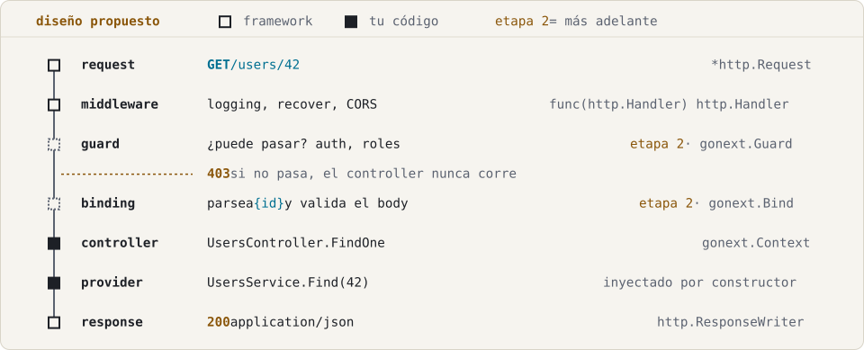

<picture>
  <source media="(max-width: 600px) and (prefers-color-scheme: dark)" srcset="assets/banner-narrow-dark.svg">
  <source media="(max-width: 600px)" srcset="assets/banner-narrow-light.svg">
  <source media="(prefers-color-scheme: dark)" srcset="assets/banner-dark.svg">
  
</picture>

**Arquitectura modular estilo NestJS, escrita en Go idiomático, sobre `net/http`.**

[Por qué](#por-qué-gonext) · [Un vistazo](#un-vistazo) · [De NestJS a GoNext](#de-nestjs-a-gonext) · [Ciclo de una request](#ciclo-de-una-request) · [Estructura](#estructura-de-un-proyecto) · [Hoja de ruta](#hoja-de-ruta) · [Contribuir](#contribuir)

> [!WARNING]
> **GoNext está en desarrollo temprano.** Todavía no hay una versión publicada y el código de este README muestra la **API propuesta**, no una API disponible. Puede cambiar en cualquier momento.

## Por qué GoNext

Go tiene una librería estándar excelente para HTTP, pero cuando una API crece aparece la misma pregunta en cada proyecto: *¿dónde va cada cosa?* GoNext responde con la estructura que hizo popular a NestJS (módulos, controllers y providers conectados por inyección de dependencias) sin dejar de ser Go.

- **La stdlib primero.** El router, los handlers y los middlewares son `net/http`. Lo que sabés de Go sigue sirviendo.
- **Módulos con límites claros.** Cada dominio (`users`, `orders`, `auth`) declara qué expone y qué necesita, desde el primer día.
- **Inyección por constructores.** Escribís funciones `New...` comunes; GoNext resuelve el orden y conecta las dependencias.
- **Legible para quien aprende.** Sin generación de código oculta ni convenciones mágicas: si algo pasa, se ve en el código.

## Un vistazo

Un módulo `users` con su servicio y su controller, un módulo raíz que lo importa y el `main` que levanta todo.

```go
// users/users.service.go
package users

type User struct {
	ID   int    `json:"id"`
	Name string `json:"name"`
}

type Service struct {
	users map[int]User
}

func NewService() *Service {
	return &Service{users: map[int]User{1: {ID: 1, Name: "Ada"}}}
}

func (s *Service) All() []User {
	out := make([]User, 0, len(s.users))
	for _, u := range s.users {
		out = append(out, u)
	}
	return out
}

func (s *Service) Find(id int) (User, bool) {
	u, ok := s.users[id]
	return u, ok
}
```

```go
// users/users.controller.go
package users

import (
	"net/http"

	"github.com/LautaroGarc/GoNext/gonext"
)

type Controller struct {
	svc *Service // lo inyecta GoNext a partir de NewService
}

func NewController(svc *Service) *Controller {
	return &Controller{svc: svc}
}

func (c *Controller) Routes(r gonext.Router) {
	r.Prefix("/users")
	r.Get("", c.FindAll)
	r.Get("/{id}", c.FindOne)
}

func (c *Controller) FindAll(ctx *gonext.Context) error {
	return ctx.JSON(http.StatusOK, c.svc.All())
}

func (c *Controller) FindOne(ctx *gonext.Context) error {
	id, err := ctx.ParamInt("id")
	if err != nil {
		return gonext.BadRequest("id inválido")
	}
	user, ok := c.svc.Find(id)
	if !ok {
		return gonext.NotFound("usuario no encontrado")
	}
	return ctx.JSON(http.StatusOK, user)
}
```

```go
// users/users.module.go
package users

import "github.com/LautaroGarc/GoNext/gonext"

var Module = gonext.Module{
	Name:        "users",
	Providers:   []any{NewService},
	Controllers: []any{NewController},
	Exports:     []any{(*Service)(nil)}, // otros módulos pueden inyectarlo
}
```

```go
// app.module.go
package main

import (
	"github.com/LautaroGarc/GoNext/gonext"
	"example.com/api/users"
)

var AppModule = gonext.Module{
	Name:    "app",
	Imports: []gonext.Module{users.Module},
}
```

```go
// main.go
package main

import (
	"log"

	"github.com/LautaroGarc/GoNext/gonext"
)

func main() {
	app, err := gonext.New(AppModule) // resuelve módulos y dependencias
	if err != nil {
		log.Fatal(err)
	}
	if err := app.Listen(":8080"); err != nil {
		log.Fatal(err)
	}
}
```

```console
$ curl localhost:8080/users/1
{"id":1,"name":"Ada"}
```

## De NestJS a GoNext

Si venís de NestJS, los conceptos se traducen así. La columna de GoNext es el diseño propuesto.

| Concepto | NestJS | GoNext |
| --- | --- | --- |
| Módulo | `@Module({ imports, providers, controllers, exports })` | `gonext.Module{Imports, Providers, Controllers, Exports}` |
| Provider | clase con `@Injectable()` | cualquier constructor `func New...() *T` |
| Inyección | parámetros del `constructor` | parámetros del constructor, resueltos por tipo |
| Controller | clase con `@Controller()` | struct con un método `Routes(gonext.Router)` |
| Ruta | `@Get(':id')` | `r.Get("/{id}", c.FindOne)` |
| Middleware | `NestMiddleware` | `func(http.Handler) http.Handler` de toda la vida |
| Guard | `CanActivate` | `gonext.Guard` *(etapa 2)* |
| Validación | `ValidationPipe` | `gonext.Bind` *(etapa 2)* |
| Errores | `HttpException` | `return gonext.NotFound(...)` desde el handler |

## Ciclo de una request

Cada request recorre el mismo camino, de arriba hacia abajo. Un guard puede cortarlo antes de que el controller llegue a ejecutarse. Guards y binding llegan en la etapa 2.

<picture>
  <source media="(max-width: 600px) and (prefers-color-scheme: dark)" srcset="assets/lifecycle-narrow-dark.svg">
  <source media="(max-width: 600px)" srcset="assets/lifecycle-narrow-light.svg">
  <source media="(prefers-color-scheme: dark)" srcset="assets/lifecycle-dark.svg">
  
</picture>

## Estructura de un proyecto

```console
$ tree api
api/
├── app.module.go        # módulo raíz: importa los demás
├── go.mod               # module example.com/api
├── main.go              # crea la app y escucha
└── users/
    ├── users.module.go      # qué expone y qué necesita el dominio
    ├── users.controller.go  # rutas HTTP → métodos
    └── users.service.go     # lógica de negocio, inyectable
```

## Hoja de ruta

El trabajo está ordenado en etapas en [`docs/ROADMAP.md`](docs/ROADMAP.md); cada item tiene su documento con la idea, las preguntas abiertas y qué investigar.

**Etapa 1: núcleo del framework.** Escribir una API chica en módulos, controllers y providers, levantarla sobre `net/http` y testearla.

- [ ] [Estructura del repositorio y del módulo Go](docs/stage-1/01-estructura-del-proyecto.md)
- [ ] [Router sobre `net/http`](docs/stage-1/02-router.md)
- [ ] [Firma de handlers y contexto de request](docs/stage-1/03-handlers-y-contexto.md)
- [ ] [Controllers](docs/stage-1/04-controllers.md)
- [ ] [Providers e inyección de dependencias](docs/stage-1/05-providers-y-di.md)
- [ ] [Módulos (imports / exports)](docs/stage-1/06-modulos.md)
- [ ] [Bootstrap y ciclo de vida de la aplicación](docs/stage-1/07-bootstrap-y-ciclo-de-vida.md)
- [ ] [Middleware](docs/stage-1/08-middleware.md)
- [ ] [Respuestas y manejo de errores](docs/stage-1/09-respuestas-y-errores.md)
- [ ] [Configuración](docs/stage-1/10-configuracion.md)
- [ ] [Logging](docs/stage-1/11-logging.md)
- [ ] [Utilidades de testing](docs/stage-1/12-testing.md)
- [ ] [Ejemplo de referencia y README](docs/stage-1/13-ejemplo-y-readme.md)

**Etapa 2: ideas para después.** Validación declarativa de DTOs, guards y autorización, interceptors, CLI para generar módulos, integración con bases de datos y OpenAPI. No se trabajan hasta cerrar la etapa 1.

## Contribuir

El proyecto está en su etapa más moldeable: es el mejor momento para opinar sobre la API.

1. Abrí un *issue* con ideas, dudas o casos de uso que la API propuesta no cubra. Las preguntas abiertas de cada item del roadmap son un buen punto de partida.
2. Para cambios de código, hacé un *fork*, creá una rama y mandá un *pull request* chico y enfocado.
3. El código va en inglés (identificadores) y la documentación en español.

## Licencia

[MIT](LICENSE) © 2026 Lautaro García
